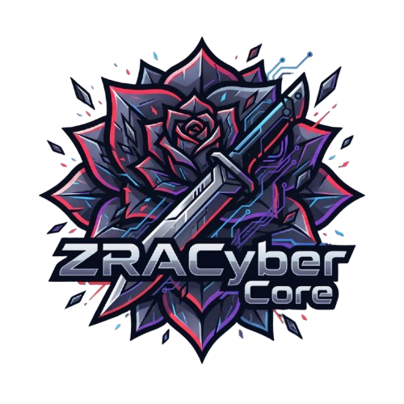

# ZRACYBER-CORE v3.0



**ZraCyber-Core** adalah platform keamanan siber (*cyber security*), audit penetrasi (*penetration testing*), intelijen jejak digital (*OSINT reconnaissance*), dan reverse engineering berkas biner modern yang menggabungkan aplikasi seluler Android (React Native / Expo) dengan pengendali utama desktop (Electron / Node.js Controller) yang ditenagai oleh mesin **Groq AI (openai/gpt-oss-120b)**.

---

> [!IMPORTANT]
> **CATATAN HASIL OSINT**:  
> Hasil pencarian berasal dari indeks publik pihak ketiga. Kecocokan nama, gambar, dan kandidat lokasi adalah petunjuk untuk ditinjau, bukan verifikasi identitas atau lokasi. Analisis AI membantu menyusun kueri dan dapat keliru.

---

## 📌 DAFTAR ISI
1. [Penjelasan Aplikasi](#-penjelasan-aplikasi)
2. [Fitur Unggulan](#-fitur-unggulan)
3. [Tabel Rangkuman Payload & Ancaman](#-tabel-rangkuman-payload--jenis-ancaman-yang-dideteksi)
4. [Rincian Fungsi Desktop Controller](#-rincian-fungsi-desktop-controller)
5. [Struktur Proyek](#-struktur-proyek)
6. [Akun Demo Resmi untuk Juri](#-akun-demo-resmi-untuk-juri--pengujian-multi-hp)
7. [Instalasi Desktop Controller (Arch, Kali, Windows)](#-instalasi-desktop-controller)
8. [Kompilasi Release APK Mobile](#-kompilasi-release-apk-mobile)
9. [Panduan Pengujian & Lab Lokal](#-cara-penggunaan--lab-uji-coba)
10. [Peringatan Hukum & Hak Cipta](#-peringatan-hukum--hak-cipta-legal-copyright-warning)

---

## 🛡️ PENJELASAN APLIKASI

ZraCyber-Core dirancang khusus untuk *Security Engineers, Penetration Testers, Bug Bounty Hunters, dan Digital Forensic Investigators* untuk melakukan audit keamanan terpadu di berbagai permukaan serangan (*attack surface*):

- **Cross-Platform Multi-Tool**: Mengintegrasikan pemeriksaan Website, Aplikasi Mobile, Berkas/Payload, pencarian OSINT publik, Server VPS, hingga Kriptografi dalam satu dasbor terpadu.
- **Orkestrasi AI Groq Cloud**: Memanfatkan kecerdasan buatan Groq AI (`openai/gpt-oss-120b` dengan `temperature: 0.0`) untuk menyusun sintesis intelijen faktual, korelasi kerentanan CVE/CWE, analisis risiko, serta kode perbaikan (*remediation patch*).
---

## 🚀 FITUR UNGGULAN

### 🌐 01. WEBSITE PENTEST
- **Audit Otomatis 13-Tahap**: Korelasi kerentanan CWE/CVE berbasis Groq AI.
- **Deteksi Celah Utama**: 
  - SQL Injection (SQLi)
  - Reflected & Stored XSS
  - Insecure Transport (TLS) & CSRF
  - Header Security & Miskonfigurasi Server
- **Website Lab Lokal**: Didukung direktori `website_lab/` (`http://127.0.0.1:3000`) untuk simulasi latihan.

### 📱 02. APP MOBILE AUDIT (Modular APK Scanner)
- **Inspeksi Biner Statis**: Analisis file APK, IPA, dan EXE sesuai standar OWASP MASTG / MASVS.
- **Rule Engine & Manifest Analyzer**: Evaluasi izin sensitif, komponen ter-export, deep links, debug flags, dan backup flags tanpa mengeksekusi biner.

### 📂 03. FILE & MALWARE ANALYSIS (Modular File Scanner)
- **Shannon Entropy**: Kalkulasi keacakan biner untuk mendeteksi *packed / obfuscated malware*.
- **Indicator Engine**: Ekstraksi URL eksternal, Alamat IP hardcoded, path sistem, dan perintah shell mencurigakan.
- **Embedded Source Code & Webshell Detector**: Mendeteksi potongan kodingan tersembunyi (`eval`, `system`, `base64_decode`).

### 🔍 04. OSINT PENCARIAN PUBLIK
OSINT mencari referensi web publik berdasarkan nama lengkap atau username melalui Google Search, mencari kecocokan visual gambar melalui Google Lens, serta membantu menemukan kandidat tempat dari foto menggunakan Lens, analisis AI, dan Google Maps. Pengguna juga dapat melihat foto publik dari tempat yang dipilih. Fitur ini membantu menghimpun referensi publik untuk ditinjau; kecocokan nama, gambar, atau tempat bukan konfirmasi identitas seseorang maupun lokasi foto.

### 🔎 05. DORKING & RECON
`tools_dorking.tsx` adalah layar pencarian halaman publik yang sudah terindeks, dengan cakupan domain atau TLD dan preset query seperti `inurl:upload`, `inurl:admin`, `filetype:pdf`, `inurl:api`, dan `ext:php`. Pencarian saat ini dilakukan melalui Bing menggunakan SerpApi (bukan Google). Secara default pencarian bersifat pasif; pemeriksaan HTTP HEAD opsional hanya tersedia untuk maksimal 10 hasil pada domain yang kewenangannya dikonfirmasi, dan tidak mengirim payload eksploit.

### 🖥️ 06. VPS & SERVER SECURITY (Dual-Mode: External & Internal)
- **External Scan (Tanpa Login)**: Audit permukaan eksternal, eksposur port terbuka (TCP 22/80/443/3306/dll.), servis, banner, dan DNS.
- **Internal Scan (Dengan Login)**: Audit terautentikasi (*Root-Level Audit*) via SSH untuk mendeteksi OS, users/sudoers, filesystem permissions, processes, network, dan aplikasi web/database.

### 🔐 07. CRYPTOGRAPHY & CIPHER CORE
- **AES-256-GCM**: Enkripsi simetris terautentikasi dengan PBKDF2-HMAC-SHA256 / Scrypt Key Derivation Function (KDF).
- **Nonce & Auth Tag**: Verifikasi integritas cipher yang kuat dan aman.

### 📄 08. LAPORAN RESMI PDF
- **Ekspor Dokumen A4**: Agregasi riwayat audit dari seluruh modul dalam satu laporan PDF resmi.
- **Struktur Profesional**: Header resmi, tabel metadata, sintesis AI, dan daftar tautan referensi.

### 💻 09. DESKTOP CONTROLLER & LIVE MAP
- **Peta Live (Leaflet Map)**: Pelacakan GPS real-time dengan 3 indikator warna:
  - **BIRU (`#3b82f6`)**: Perangkat Terdaftar Resmi (*Registered Device*).
  - **KUNING (`#eab308`)**: Perangkat Akun Demo Juri (*Judge Demo Account*).
  - **MERAH (`#ef4444`)**: Perangkat Anomali / Belum Terdaftar (*Anomalous Device*).
- **OTA Mobile Update**: Publikasi file APK rilis baru secara otomatis ke seluruh perangkat HP dengan sistem *Mandatory Lockdown Update*.

---

### 📋 Tabel Rangkuman Payload & Jenis Ancaman yang Dideteksi

| Modul Toolkit | Jenis Payload / Target Audit | Metode Deteksi & Analisis |
| :--- | :--- | :--- |
| **Website Pentest** | SQLi, XSS, CSRF, TLS & Auth Session (Tanpa / Dengan Login) | Fuzzing parameter aktif, korelasi error & crawling form |
| **App Mobile Audit** | MASTG Storage, Plaintext SharedPreferences & Signature Tampering | Inspeksi manifes, biner & verifikasi sertifikat APK |
| **File & Malware** | High Entropy Packed, Webshell Scripts (`eval`, `system`, `base64`) & IoC | Shannon Entropy (> 7.2 bit/byte) & deep string regex |
| **OSINT Pencarian Publik** | Referensi web untuk nama/username, kecocokan visual gambar, kandidat tempat, dan foto publik Maps | Google Search, Google Lens, Google Maps, dan analisis AI untuk membantu membentuk kueri tempat |
| **Dorking & Recon** | Halaman publik terindeks berdasarkan domain/TLD dan preset query | Bing via SerpApi; pemeriksaan HTTP HEAD opsional pada maksimal 10 hasil domain terkonfirmasi |
| **VPS Server Audit** | SSH Hardening, Cron Persistence & Post-Auth IDOR/Webshell | Inspeksi port 22, crontab anomali & autentikasi sistem |
| **Cryptography** | AES-256-GCM & Scrypt Key Derivation Function (KDF) | Enkripsi simetris terautentikasi (Nonce + Auth Tag) |

---

## 💻 RINCIAN FUNGSI DESKTOP CONTROLLER

Aplikasi Desktop Controller (Electron / Node.js) berfungsi sebagai pusat komando dan server pengolah utama untuk seluruh perangkat mobile:

1. **Pusat Server HTTP API (Port 4317)**:
   - Melayani permintaan pemindaian dari HP untuk modul Website Pentest, App Audit, File Malware, OSINT, VPS, dan Kriptografi secara aman.
   - Mendukung rute publik terobosan terowongan (*Bypass Ngrok Header*) untuk pengujian jarak jauh via internet seluler.

2. **Peta Live (Leaflet GPS Live Map)**:
   - Menampilkan posisi geografis real-time seluruh perangkat HP yang terhubung dengan 3 indikator status warna dinamis (Biru, Kuning, Merah).
   - Pembaruan status warna dan koordinat berjalan secara *real-time* tanpa perlu me-restart aplikasi.

3. **Pengelolaan Perangkat & Akses Keamanan (Device Manager)**:
   - Manajemen daftar perangkat terdaftar, pembatasan akses, serta fitur pemblokiran (*block/unblock device*) instant.
   - **Pemutusan Akses Universal**: Perangkat yang diblokir langsung mendapati status HTTP 423 di semua endpoint dan terkunci dari semua tab.

4. **Log & Laporan Gabungan Multi-Device**:
   - Mengumpulkan seluruh hasil audit (*Write-up*) dari berbagai HP yang terhubung secara otomatis.
   - Tampilan kartu laporan yang dapat diperluas (*expandable details*) dan tombol cetak PDF native.

5. **Pusat Publikasi Update APK Mobile (OTA Release Publisher)**:
   - Fitur `⇧ Update APK mobile` memungkinkan admin mempublikasikan file APK rilis baru langsung ke seluruh HP secara *Over-The-Air* dengan sistem *Mandatory Lockdown Update*.

6. **Fitur Pemblokiran & Uninstall Paksa Remote (Remote Force Wipe & Device Revocation)**:
   - Apabila perangkat seluler terdeteksi melakukan tindakan anomali atau perintah pencopotan dipicu, admin desktop dapat mengaktifkan **Lockdown & Force Uninstall Paksa** yang langsung menghapus data lokal (*wipe*) dan mengunci antarmuka seluler.

---

## 🏗️ ARSITEKTUR SISTEM

```
┌─────────────────────────────────────────────────────────┐
│                    MOBILE APP (React Native / Expo)     │
│  [Web Pentest] [App Audit] [File] [OSINT] [VPS] [Crypto]│
└────────────────────────────┬────────────────────────────┘
                             │ REST API / HTTP (Bypass Ngrok)
                             ▼
┌─────────────────────────────────────────────────────────┐
│               DESKTOP CONTROLLER (Electron / Node.js)   │
│            Server HTTP Port 4317 · Live Map · History   │
└────────────────────────────┬────────────────────────────┘
                             │ HTTPS API Call
                             ▼
┌─────────────────────────────────────────────────────────┐
│                  GROQ CLOUD AI ENGINE                   │
│             Model: openai/gpt-oss-120b                  │
└─────────────────────────────────────────────────────────┘
```

---

> [!TIP]
> **URL NGROK RESMI ADMIN**:  
> `https://popular-shorten-imperial.ngrok-free.dev`

---

## 💻 INSTALASI DESKTOP CONTROLLER

### A. Arch Linux / Manjaro:
```bash
sudo pacman -Syu nodejs npm git libxcrypt-compat
cd desktop
npm install
npm start
```

### B. Kali Linux / Debian / Ubuntu:
```bash
sudo apt update && sudo apt install -y nodejs npm git libgtk-3-0 libnotify4 libnss3 libxss1 libasound2
cd desktop
npm install
npm start
```

### C. Windows 10 / 11 (PowerShell):
```powershell
node -v
cd desktop
npm install
npm start
```

---

## 📱 KOMPILASI RELEASE APK MOBILE

```bash
cd android
export PATH=$PATH:/usr/bin:/usr/local/bin
env -u ANDROID_PREFS_ROOT JAVA_TOOL_OPTIONS="--enable-native-access=ALL-UNNAMED" ./gradlew assembleRelease
```
> **Lokasi File APK Hasil Build:**  
> `android/app/build/outputs/apk/release/app-release.apk`

---

## 👥 AKUN DEMO RESMI UNTUK JURI & PENGUJIAN MULTI-HP

Platform ZraCyber-Core menyediakan **6 Akun Demo Khusus Juri** yang dapat langsung dipilih dari tab **Profil** aplikasi mobile untuk pengujian instan tanpa perlu mendaftarkan API key manual:

1. 🛡️ **Drs. Zhafran Zky (Lead Auditor)** — *Chief Cyber Security Auditor & Lead Penetration Tester*  
   - Key: `zra_demo_lead_auditor_2026_key`
2. 🌐 **Rubby Wirassmara (Web Specialist)** — *Senior Web Security & Bug Bounty Specialist*  
   - Key: `zra_demo_web_specialist_2026_key`
3. 📱 **Dr. Dzaky (Mobile Forensic Lead)** — *Android & iOS Binary Reverse Engineer*  
   - Key: `zra_demo_mobile_forensic_2026_key`
4. 📂 **Auditor DFIR (Malware Specialist)** — *Digital Forensics & Incident Response Specialist*  
   - Key: `zra_demo_malware_dfir_2026_key`
5. 🔍 **Investigator OSINT (Recon Lead)** — *Social Media & Identity Intelligence Analyst*  
   - Key: `zra_demo_osint_recon_2026_key`
6. 🖥️ **Judge Infra (Server Inspector)** — *Infrastructure & Cloud Security Inspector*  
   - Key: `zra_demo_vps_infra_2026_key`

> [!NOTE]
> **Dukungan Multi-HP Simultan**:  
> Seluruh 6 Akun Demo juri dapat digunakan oleh **beberapa HP fisik yang berbeda secara bersamaan (*simultaneous multi-device*)** tanpa saling menendang atau memblokir satu sama lain. Setiap perangkat akan otomatis muncul dengan penanda berwarna **Kuning** di Peta Live Desktop Controller.

---

## 📖 CARA PENGGUNAAN & LAB UJI COBA

### 1. Menghubungkan Aplikasi HP ke Laptop:
1. Jalankan Desktop Controller (`npm start`) di laptop.
2. Gunakan URL Ngrok resmi: `https://popular-shorten-imperial.ngrok-free.dev`.
3. Di HP, buka tab **Profil**, pilih salah satu **Akun Demo Juri**, lalu klik **Hubungkan ke Desktop (Login)**.

### 2. Menguji Modul Website Pentest (Lab Web Lokal):
```bash
node website_lab/server.cjs
```
- Target URL: `http://127.0.0.1:3000` (Kredensial: `labuser` / `lab-only-change-me`).

### 3. Menggunakan Dorking & Recon:
- Pastikan SerpApi key sudah dikonfigurasi di Desktop Controller pada pengaturan **Bing Search**.
- Masukkan domain yang berwenang kamu periksa atau TLD, lalu pilih preset query dan jalankan pencarian.
- Pencarian bersifat pasif secara default. Untuk domain yang kamu kelola, centang konfirmasi kewenangan agar maksimal 10 hasil diperiksa dengan HTTP HEAD. Pemeriksaan ini membaca status/header, bukan menguji payload eksploit.

### 4. Menggunakan OSINT Pencarian Publik:
- Pilih **Nama lengkap** atau **Username** untuk mencari referensi web publik di Google.
- Pilih **Gambar Google** untuk mencari kecocokan visual melalui Google Lens, atau **Google Maps dari Foto** untuk memperoleh kandidat tempat berdasarkan gambar.
- Pada hasil Maps, pilih tempat yang sesuai untuk melihat foto publik dan gunakan tombol pemuatan foto berikutnya jika tersedia.
- Kecocokan pencarian adalah petunjuk untuk ditinjau, bukan konfirmasi identitas atau lokasi. Gambar yang diunggah dibatasi maksimal 500 KB.

### 5. Menguji Modul File & Malware Analysis (File Lab Lokal):
- Pilih sampel `suspicious_invoice.pdf` dari direktori `file_lab/` untuk mendeteksi payload webshell.

---

## 📁 STRUKTUR PROYEK

```
Application/
├── app/                      # Aplikasi Mobile (Expo Router)
│   ├── (tabs)/               # Tab Navigasi (Ringkasan, Security, Laporan, Chat, Profil)
│   ├── tools_website.tsx     # Modul Website Penetration Testing
│   ├── tools_app.tsx         # Modul App Mobile Audit
│   ├── tools_file.tsx        # Modul File & Malware Analysis
│   ├── tools_osint.tsx       # Modul OSINT Google Search, Lens & Maps
│   ├── tools_dorking.tsx     # Modul Dorking & Recon
│   ├── tools_vps.tsx         # Modul VPS & Server Security
│   └── tools_cryptography.tsx# Modul Kriptografi & Cipher
├── desktop/                  # Dasbor Desktop Controller (Electron)
│   ├── src/                  # Server API (Port 4317), Main & Renderer UI
│   ├── core/                 # Validator, Hash, MIME, Evidence Graph, Rule Engine
│   ├── scanners/             # Modular Scanners (APK, File, VPS External/Internal)
│   ├── ai/                   # Groq AI Correlator & Write-up Generator
│   └── reports/              # JSON & HTML Report Generators
├── website_lab/              # Lab Simulasi Website Demo (Auth, CSRF, CSP)
│   ├── server.cjs            # Server Web Target Lab Lokal (Port 3000)
│   ├── package.json          # Konfigurasi dependensi lab
│   ├── Dockerfile            # Konfigurasi container lab
│   ├── .env.example          # Contoh variabel lingkungan
│   ├── styles.css            # Styling halaman lab
│   └── README.md             # Panduan Pengujian Web Lab
├── file_lab/                 # Lab Simulasi Malware File (Suspicious PDF)
│   ├── suspicious_invoice.pdf# Berkas Sampel PDF Berisi Simulasi Webshell
│   └── README.md             # Panduan Pengujian File Lab
├── android/                  # Proyek Native Android (Gradle)
└── README.md                 # Dokumentasi Resmi Proyek
```

---

## ⚖️ PERINGATAN HUKUM & HAK CIPTA (LEGAL COPYRIGHT WARNING)

> [!CAUTION]
> **DILARANG KERAS MENGGANDAKAN, MENDISTRIBUSIKAN, ATAU MEMPERJUALBELIKAN TANPA IZIN RESMI PEMILIK HAK CIPTA**:  
> Seluruh kode sumber, arsitektur sistem, rancangan antarmuka, dan dokumentasi proyek **ZraCyber-Core** dilindungi secara penuh oleh Undang-Undang Hak Cipta Republik Indonesia. Setiap instansi, organisasi, maupun perorangan yang melakukan penyalinan, pemalsuan, atau penggunaan komersial tanpa izin tertulis dari pemilik hak cipta akan ditindak tegas melalui jalur hukum:
> 
> - **Gugatan Perdata (UU Hak Cipta Pasal 95)**: Pemilik hak cipta berhak mengajukan gugatan ganti rugi materiil maupun immateriil ke Pengadilan Niaga atas setiap penggunaan tanpa izin.
> - **Sanksi Pidana Komersial (UU Hak Cipta Pasal 113)**: Jika proyek/kode sumber ini didistribusikan, diduplikasi, atau dijual secara ilegal untuk tujuan komersial, pelanggar terancam **pidana penjara paling lama 4 (empat) tahun** dan/atau **denda hingga Rp1.000.000.000,- (satu miliar rupiah)**.
> 
> **KONTAK HAK CIPTA & LISENSI RESMI**:  
> Untuk permohonan izin tertulis, lisensi komersial, atau pertanyaan hak cipta:  
> - **Email**: `zakzakidzak@gmail.com`  
> - **Instagram**: `@zhafrand_ak`

---

**ZraCyber-Core Intelligence & Penetration Testing Platform © 2026**  